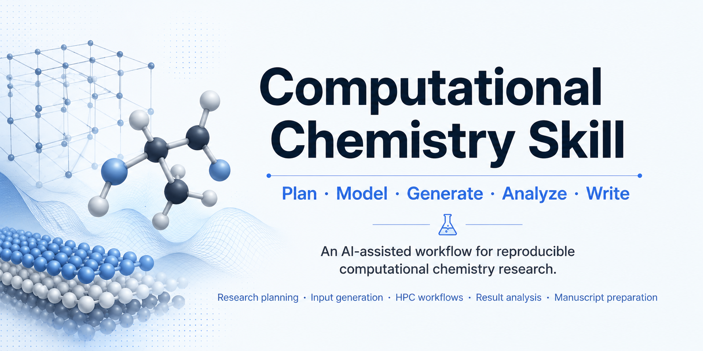

<p align="center">
  
</p>

<h1 align="center">Computational Chemistry Skill</h1>

<p align="center"><strong>面向计算化学研究的分阶段方案设计、浏览器审查、计算准备、结果分析与科研说明工作流</strong></p>

<p align="center">
  
  
  
  
  
</p>

<p align="center">
  <a href="#快速开始"><strong>快速开始</strong></a> ·
  <a href="#完整工作流"><strong>完整工作流</strong></a> ·
  <a href="#浏览器审查与回传"><strong>浏览器审查</strong></a> ·
  <a href="#方案编辑界面"><strong>方案编辑</strong></a> ·
  <a href="#科学与软件边界"><strong>使用边界</strong></a>
</p>

Computational Chemistry Skill 将研究目标、实验现象、结构信息、软件条件和计算限制转换为可审查、可追踪的计算化学工作流。它不只生成参数或输入文件，而是围绕科学问题建立“研究目标—计算任务—证据要求—实际输入输出—分析结论—论文说明”的完整来源链。

该 Skill 适用于计算化学、量子化学、材料模拟、体相、表面、缺陷、吸附、界面和分子模拟研究。普通用户通过自然语言与结构化表单完成方案修改，不需要理解 JSON；技术用户可使用高级 JSON 模式检查或调整完整结构化数据。

## 核心能力

| 能力 | 说明 |
|---|---|
| 科学问题拆解 | 将研究目标拆分为相互独立、能够形成证据链的计算任务，避免不同计算重复说明同一问题 |
| 模型与结构设计 | 设计体相、表面、缺陷、吸附和界面候选，并记录结构来源、构建规则和审批状态 |
| 计算方案设计 | 明确使用什么软件、什么模块、计算什么参数，以及该参数能够支持或不能支持哪些结论 |
| 渐进式信息采集 | 简单需求先逐步确认目标、结构、软件版本、运行环境、所需文件和关键参数，资料完整前不生成文件 |
| 输入文件准备 | 审查确认后只生成目标软件必需的文件和唯一的 `README.md`；提交脚本仅按需生成 |
| 浏览器终审 | 信息完整后生成固定的 `.review/review.html`，修改时覆盖同一文件，自动打开失败不阻断流程 |
| 受控 PowerShell 7 | Windows 操作可使用带固定非交互参数和超时的 `pwsh`，但它不是科学分析或流程推进的单点依赖 |
| 高级项目追踪 | 已初始化的高级项目可显式使用不可变版本、内容哈希、证据链和项目控制记录 |
| 结果验收 | 检查用户返回的真实输入、输出、日志、结构和数据是否完整、有效且可比较 |
| 数据处理指导 | 用户不知道如何处理数据时，先给出编号化教程；用户上传处理后数据后，再进行针对性分析 |
| 科研结论与写作 | 根据真实计算记录生成分析结论、计算方法、论文说明、证据边界和来源追踪 |
| 软件合规说明 | 如实记录商业软件及版本，同时提供开源软件复现或迁移建议，不篡改真实结果来源 |

## 完整工作流

```text
简单计算需求
    ↓
阶段 1：逐步确认目标、结构、软件/版本、运行环境、所需文件与关键参数
    ↓ 资料完整并通过一致性检查
.review/review.html 最终审查（修改时覆盖）
    ↓ 用户确认
最小计算目录：必要输入/结构/参数文件 + 唯一 README.md
    ↓ 用户在本地或集群运行
返回真实输入、输出、日志和最终结构
    ↓
结果验收、证据分析与科研说明
```

需要表面/界面候选、不可变版本、哈希审批、跨阶段来源追踪或归档的用户，可显式启用高级项目流程。高级流程保留原有阶段 2.1–5 及其实际脚本，但不是简单需求的默认入口。

## 阶段说明

### 阶段 1：科学问题与计算方案

阶段 1 先通过对话逐步明确研究目标、结构或已有文件、软件及版本、运行位置、环境加载方式、所需交付文件、需要回传的结果文件和关键参数。用户只需要输入文件时，不询问无关的调度资源；只有请求提交脚本时才采集 Slurm 等资源参数。

在资料完整和一致性检查通过前，不生成审查页面、计算参数文件或审查记录。简单一句“帮我用 CP2K 优化这个结构”会进入询问，而不会直接生成文件。

每项任务都明确记录：使用的软件与模块、研究体系、直接计算参数、参数所代表的物理或化学性质、能够支持的结论、不能支持的结论、前置依赖、与其他任务的相互佐证关系、优先级和预计成本。

### 阶段 2.1：表面、缺陷或基础模型

根据已经批准的科学问题构建候选模型，记录晶面、终止方式、层数、真空层、超胞、固定层、缺陷、掺杂、官能化、净电荷、自旋状态和结构来源。用户批准候选后，才进入后续组合模型设计。

### 阶段 2.2：吸附或界面模型

在已批准基础模型上处理晶格匹配、旋转、应变、平移、层间距、接触位点、周期性、固定区域和候选排序。每个候选均保留构建参数、版本和审批记录。

### 阶段 2.3：正式计算准备

按照任务依赖顺序生成几何优化、静态计算、能量、吸附能、差分电荷密度、原子电荷、DOS/PDOS、COHP/COOP、QTAIM、分子动力学或其他任务所需的最小文件集合。运行命令、参数说明、预期输出和回传要求合并进唯一的 `README.md`。

生成文件后，工作流会进入等待用户回传真实计算结果的状态。用户不需要保持页面持续打开，但应保留本次对话；正式科研软件、作业提交和远程计算由用户完成，计算结束后再返回同一对话上传实际输入、输出、日志和最终结构。

### 阶段 3：结果处理与证据分析

用户已经完成数据处理时，Skill 直接根据上传数据给出针对性分析、可支持结论、异常点、可比性判断和证据强度。用户不知道如何处理时，Skill 先给出整体步骤和编号化教程，用户可直接询问某一步，或说明当前进行到哪一步。

分析不以自动绘图为默认目标，而是强调数据处理口径、单位、参考态、计算条件、误差来源和科学结论之间的一致性。

### 阶段 4：结论与论文计算说明

论文计算说明只基于用户真实运行的输入、输出、日志和版本信息生成。内容包括软件、版本、模块、方法、基组或赝势、色散修正、U 值、自旋、k 点、截断能、收敛标准、约束、边界条件、结构来源和实际修改记录。

如计算使用非开源软件，Skill 会如实说明真实软件，并给出开源软件复现或迁移建议。开源替代说明不会被伪装成原始结果的实际计算来源，也不要求用户为撰写说明重新计算。

### 阶段 5：归档与交付

最终交付包含已批准方案、模型版本、实际输入输出、处理数据、证据节点、分析结论、论文说明、缺失项、软件替代建议、来源链和建议清理清单。任何删除操作都需要用户明确确认。

## 浏览器审查与回传

默认审查只在阶段 1 资料完整且一致性检查通过后发生，文件名固定为：

```text
.review/review.html
```

用户要求修改时覆盖原文件，不生成 `review_v1.html`、`review_v2.html`、`review_final.html` 或历史副本。只有自动回传机制确有需要时，才允许同时使用 `.review/review_response.json`；静态页面不会预先生成空响应文件。

页面使用表单、下拉框、开关和数字输入框展示关键设置。用户不需要直接编辑大段 JSON。自动打开浏览器属于便利功能：失败时直接提供页面的绝对路径或经过验证的本地地址，不阻断审查或科学分析。

已初始化的高级项目仍可显式使用仓库中已有的 Flask 审查服务、`review_request.json`、`review_decision.json` 和内容哈希校验。它们是兼容模式的真实实现，不是默认简单流程，也不会被复制进正式计算目录。

## 方案编辑界面

方案编辑页面默认使用结构化表单，不直接要求普通用户编辑完整 JSON。研究目标、科学问题、计算任务、软件、方法、参数、依赖关系和替代方案分别使用自然语言字段、卡片、选择器和可排序控件。

| 表单模式 | 高级 JSON 模式 |
|---|---|
| 默认入口，适合无编程基础的用户 | 适合熟悉结构化数据和 Schema 的技术用户 |
| 研究目标和科学问题使用自然语言字段 | 显示完整候选方案数据与字段路径 |
| 科学问题与任务使用卡片增删、排序和设置依赖 | 支持语法高亮、格式化、撤销和错误定位 |
| 系统自动维护内部 ID、依赖关系和人工覆盖记录 | 保存前执行 JSON 语法和 Schema 校验 |
| 字段旁显示解释、示例、建议和实时错误 | 无效 JSON 不会覆盖当前有效表单数据 |

两个模式操作同一份结构化数据。模式切换、保存草稿、生成版本和提交审批前均执行数据一致性检查，未知扩展字段、内部 ID、数组顺序、依赖引用和 `manual_overrides` 不会丢失。

受保护字段不要求用户手动编写 `manual_overrides`。用户修改受保护字段时，页面要求填写修改理由，并自动记录字段路径、原值、新值、修改理由和修改时间。

## 版本、差异与风险分析

默认终审修改会覆盖同一个 `.review/review.html`。已初始化的高级项目可继续形成独立方案版本，并提供版本历史、前后差异、科学权重变化、工作量变化、证据链变化、结果影响和风险提示。

普通用户默认看到自然语言差异，例如研究目标变化、科学问题新增或删除、任务与参数变化、依赖调整、工作量变化和结论范围变化。技术用户可进一步查看字段路径级 JSON Diff。

## 建议的前置软件

建议使用独立的 Python 3.10 或更高版本环境运行本 Skill，避免与已有科研软件环境发生依赖冲突。浏览器审查、Schema 校验和项目状态控制所需的基础依赖由仓库的 `requirements.txt` 管理：

```text
python -m pip install --upgrade pip
python -m pip install -r requirements.txt
```

涉及晶体、表面、界面、结构文件或对称性处理时，建议另外安装以下计算化学工具：

| 软件 | 建议用途 | 要求级别 |
|---|---|---|
| [ASE](https://docs.ase-lib.org/) | 原子结构读写、结构构建、晶胞与周期性信息处理 | 结构工作流强烈建议 |
| [pymatgen](https://pymatgen.org/installation.html) | 晶体与分子结构解析、材料结构操作及格式转换 | 材料工作流强烈建议 |
| [spglib](https://spglib.readthedocs.io/en/stable/python-interface.html) | 空间群、晶体对称性和标准化检查 | 周期体系强烈建议 |
| NumPy | 坐标、晶格和数值数组处理 | 通常由上述工具自动安装 |

可以使用以下命令安装建议组件：

```text
python -m pip install ase pymatgen spglib numpy
```

这些库不是正式科研计算程序，也不会使 Skill 自动运行计算。Quantum ESPRESSO、CP2K、Gaussian、ORCA、GROMACS 或其他计算引擎应根据已批准方案由用户另行安装、授权并执行。若 ASE、pymatgen 或 spglib 缺失，纯方案规划和浏览器审查仍可使用，但依赖真实结构解析、构建或对称性检查的阶段可能暂停并报告缺失依赖。

## 快速开始

加载仓库根目录中的 `SKILL.md` 作为 Skill 入口，然后直接描述需求。资料不足时，Skill 会逐步询问，不要求一次写完所有技术细节。

最小启动示例：

```text
帮我用 CP2K 优化这个结构。
```

Skill 会先询问优化目标和结构文件，再确认 CP2K 版本、运行位置、环境加载方式、所需文件、需要回传的结果和关键参数。信息完整前不会生成审查页面或计算文件；信息完整后才生成一次 `.review/review.html`。

用户完成正式计算后，可以返回：

```text
我已经完成计算，下面上传实际输入文件、输出文件、日志和最终结构，请进行完整性验收并告诉我下一步需要处理哪些数据。
```

用户已经完成数据处理时，可以返回：

```text
下面是我处理后的能量、结构和电子性质数据，请结合已批准的科学问题进行针对性分析，并区分已证明、部分支持和尚未证明的结论。
```

## 预期输入与输出

| 输入 | 说明 |
|---|---|
| 研究目标 | 需要回答的科学问题、比较对象和期望证据 |
| 实验信息 | 已知现象、测试条件、样品状态及其不确定性 |
| 结构与模型 | 分子、晶体、表面、吸附、界面或其来源说明 |
| 软件约束 | 实际软件、版本、许可证、模块和计算环境 |
| 计算记录 | 用户真实运行的输入、输出、日志和最终结构 |
| 处理后数据 | 用户整理后的能量、结构、谱图、电子性质或统计结果 |

| 输出 | 说明 |
|---|---|
| 研究方案 | 科学问题、证据任务、依赖关系、优先级和成本 |
| 模型候选 | 结构来源、构建规则、参数版本和审批记录 |
| 计算文件 | 目标软件必需的输入、结构或参数文件，以及唯一的 `README.md` |
| 审查页面 | 完整信息对应的 `.review/review.html`；自动回传确有需要时才包含响应 JSON |
| 分析结论 | 基于真实记录和处理后数据形成的证据判断 |
| 论文说明 | 软件、版本、方法、参数、边界和来源链说明 |
| 交付归档 | 版本、证据、缺失项、风险和建议清理清单 |

## 科学与软件边界

Skill 负责规划、生成、检查、指导、记录和说明。静态检查通过只表示文件结构、语法或必填字段符合规则，不表示计算一定收敛；程序正常结束也不自动表示模型合理或科学结论成立。

正式科研计算、远程作业提交和超算操作由用户执行。Skill 不自动连接 SSH，不代替用户提交 `sbatch`、`qsub`、`bsub`、`srun` 或其他远程任务，也不在未经确认的情况下覆盖或删除用户文件。WSL 和 Linux 优先使用 Bash 与软件原生命令。

Windows 本地自动化可受控使用 PowerShell 7，统一调用 `pwsh -NoLogo -NoProfile -NonInteractive`，设置超时并检查输出与错误。Windows PowerShell 5.1 不是默认执行器；PowerShell 失败不会终止科学分析或文件生成，也不会触发无限重试。

计划参数与用户真实运行参数分开保存。论文计算说明只依据实际记录生成。商业软件必须按照真实使用情况报告；开源软件替代仅作为复现、迁移或方法说明建议，不能被描述为原始结果的实际来源。

## 数据与科研诚信

不要上传账户凭据、SSH 私钥、许可证文件、许可证服务器地址或包含敏感身份信息的集群配置。未发表结构、计算结果和合作数据应遵循最小必要原则，并尽量使用相对路径、匿名项目编号和脱敏材料。

所有结论均需要能够回溯到真实证据。证据不足时，输出会明确区分“已证明”“部分支持”“尚未证明”和“需要补充”，不会用完整流畅的文本掩盖缺失记录或不确定性。

## 仓库结构

```text
Computational-chemistry-skill/
├── README.md
├── SKILL.md
├── agents/             # Codex 技能展示与默认提示元数据
├── assets/             # 各阶段审查页面与方案编辑器资源
├── evals/              # 工作流路由和各阶段评估案例
├── references/         # 软件、方法、参数与科学边界
├── scripts/            # 审查服务、状态处理和确定性工具
│   ├── staged_review.py # 默认渐进采集完整性检查与单页终审
│   └── review_ui/      # 浏览器审查前后端
├── tests/              # 默认流程和发布契约的可执行测试
├── docs/               # 使用、页面、验证和故障排查文档
└── .github/            # CI、Issue、PR 与仓库协作配置
```

`SKILL.md` 是 AI 执行入口，README 是用户阅读入口。阶段规则和软件方法边界由 `references/` 管理，确定性页面服务、状态控制和验证程序由 `scripts/` 管理。

## 许可证

本项目采用 MIT License。科研软件、赝势、基组、力场、数据库和第三方资源仍受各自许可证和引用要求约束。
